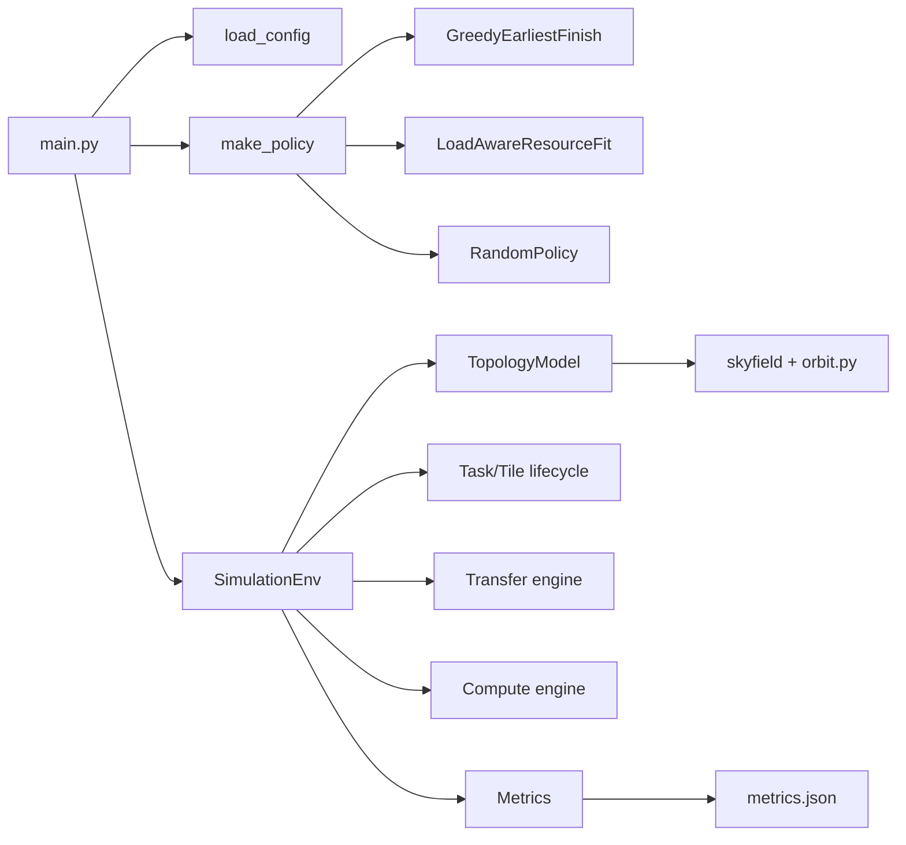
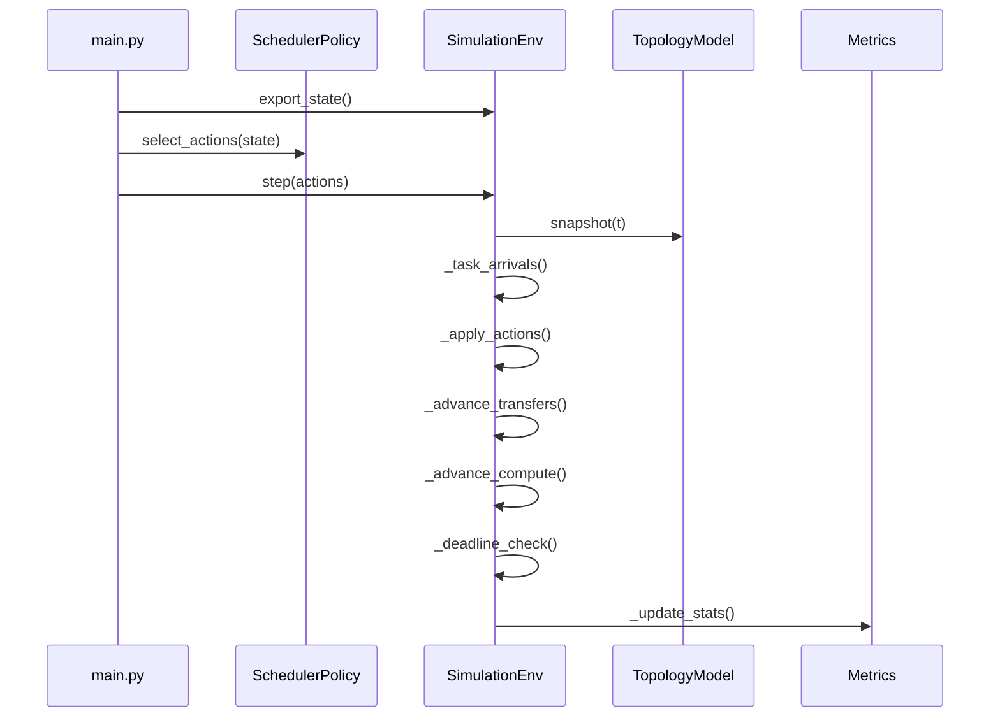

# 基于星间通信约束的分布式任务调度仿真器

## 当前研究版本（模型 v2.0）

研究目标：面向遥感图像处理，训练每星独立执行的小型多智能体调度策略，在保持完整任务完成率的前提下，相对全部地面计算缩短整图结果交付时延。目前已提供 IPPO、MAPPO、Co-MAPPO 学习组件适配版及任务条件化目的地注意力原型。领域论文完整方法尚未复现，算法优势尚待验证。

- 研究计划、文献候选及实验协议：[docs/research_plan.md](docs/research_plan.md)。
- 本轮测试、训练与配对评估记录：[docs/validation_report.md](docs/validation_report.md)。
- 候选方法、特征消融与多种子实验入口：[docs/task_marl_method.md](docs/task_marl_method.md)。
- Co-MAPPO 的原方法组成和复现差距：[docs/comappo_mapping.md](docs/comappo_mapping.md)。
- 第一版多种子开发试验及无效场景诊断：[docs/task_marl_pilot_report.md](docs/task_marl_pilot_report.md)。
- 硕士中期六章工作稿与验收清单：[docs/thesis/README.md](docs/thesis/README.md)。
- 早期模型行为审计（当时验证场景全部选择本地计算）：[docs/thesis/behavior_audit.md](docs/thesis/behavior_audit.md)。最新角色训练与行为另见下方记录。
- 可执行协同机会与交付瓶颈诊断：[docs/thesis/cooperation_feasibility.md](docs/thesis/cooperation_feasibility.md)。
- 多星座、多轨道与多负载训练：[docs/thesis/training_distribution.md](docs/thesis/training_distribution.md)，分布配置为 `examples/scenario_distribution.json`。
- 最新研究边界：[docs/thesis/research_scope.md](docs/thesis/research_scope.md)；完整交付和全地面对照：[docs/thesis/delivery_evaluation.md](docs/thesis/delivery_evaluation.md)。
- 有限邻居、接触预测、完整回报训练和小 actor 导出：[docs/thesis/predictive_training.md](docs/thesis/predictive_training.md)。包含失败实验与同条件强基线，尚无稳定 MARL 优势结论。
- 遥感轨道与专用计算节点：[docs/thesis/orbit_architecture.md](docs/thesis/orbit_architecture.md)。包含保持源星轨道/总算力的布局对照、预测时域与强地面敏感性，以及单成像源的机制案例。
- 专用成像角色的多场景学习：[docs/thesis/role_training.md](docs/thesis/role_training.md)。使用 `config_roles.yaml` 与 `scenario_roles.json` 配套运行，自动生成不同星数的成像/计算分工，包含共享算力场景及 MAPPO/IPPO 对照。
- 共同结果中继下的训练改进：[教师纠偏](docs/thesis/imitation_optimization.md)、[有效决策分批与 PPO 稳定性](docs/thesis/active_ppo_optimization.md)。训练与选模使用等权 30/60/120/240 分钟完整交付评分，保留示范与强化学习的分阶段结果。
- 当前优化诊断：[价值校准与学习信号](docs/thesis/value_calibration.md)、[研究瓶颈与调整标准](docs/thesis/research_bottlenecks.md)。区分价值预测改善、实际调度收益与尚未完成的论文证据。
- 新调度候选：[计算与回传容量预约](docs/thesis/reservation_scheduling.md)，支持 `reservation` 与相同预测下的 `reservation_independent` 消融，优先验证多源竞争的实际交付收益。
- 整图预检：[滚动接纳实验](docs/thesis/joint_admission.md)，`reservation_joint_sequential` / `reservation_joint` 在公共四分片动作限制下预检所有未分配兄弟分片；开发增益较小，保留接触预测退化证据。
- 预测与等待：[接触预测实验](docs/thesis/forecast_reservation.md)，新增服务日历、保守接单、多段回传与 `reservation_deferred` 等待机会对照，区分可行报价与真实交付。
- 时间：轨道、窗口、计算和传输统一按 `dt` 秒推进；指标时延为秒，事件中的 `time` 仍为步号。
- 通信：同向星间传输共享容量，双向全双工；每站 `receive_channels` 默认 1，`bandwidth_mbps` 为每通道带宽。原始数据和结果共享接收容量，每星同时最多接入一个站。以时间步轮转接入，暂不建模天线切换开销。
- 决策：所有策略每星每步最多处理 4 个按等待时长排序的候选 tile。`LOCAL` 表示进入执行队列，`READY` 状态不会因后续 `WAIT` 被暂停。
- 训练：GAE 按时间和 agent 两个维度计算；训练与推理共享动作 mask；MAPPO 仅训练 critic 使用全体 agent 的观测，actor 分布式执行。
- 模型选择：固定验证种子上的 task 完成率优先、已完成任务平均时延次之。测试种子禁止与训练/验证种子重叠。
- 原始 `results/`、旧实验报告和 `checkpoints/smoke_*` 是历史产物。旧 checkpoint 缺少语义版本，加载时会明确拒绝，需重新训练。
- 没有任务完成时，时延为 JSON `null`；延迟统计仅覆盖已完成任务，必须和完成率一起解释。
- 完整交付：所有分片到达地面后，统一增加 `ground_relay_delay_s + aggregation_delay_s`，向上取整到时间步；两项默认 0，地面汇聚暂不模拟拥塞。任务奖励在聚合交付时产生。
- 可选执行规则：`execution_commitment: true` 时，LOCAL 排队或邻星接收后的 READY 分片固定执行，不再允许排队中改派；默认 false。所有适用基线应保持相同设置。
- 预测配置：`topology.max_neighbors` 限制物理连接两端度数，0 为不限制；`predict_contacts` 启用确定性几何接触计划，`precompute_visibility` 可批量缓存地面窗口几何。策略输入仍不包含未来任务或真实未来带宽。
- 角色配置：`task_source_sat_ids` 指定产生成像任务的卫星，其他节点不产生任务；`satellite_compute_rates` 为长度等于 `num_sats` 的逐星算力列表。两项默认 None，分别使用全体卫星及统一 `compute_rate`。单源承诺执行场景不等同于多个有效决策 agent。
- v2 训练分布通过角色模板生成上述列表，并按成像源数量缩放总任务强度；旧 v1 分布仍可复算。`role_contact` 输入保留高计算量和拥塞差异，旧输入定义不变。论文曲线可用可选依赖 `requirements-analysis.txt` 和 `analysis/plot_role_training.py` 生成。
- 配对评估：`evaluate_policies.py` 默认包含 `ground_compute,local,greedy,window_aware`；保存 `task_outcomes` 和共同完成任务的配对时延，同时披露各方法独有完成、失败与未完成数量。`--drain-steps` 增加停止到达后的固定排空期；配置中的 `task_arrival_end_step` 为不再产生任务的首个步号。

本仓库现有 `.venv` 使用 Python 3.12；`.python-version` 中的历史 3.14 配置未作迁移。优先使用已配置的本地环境：

```bash
.venv/bin/python -m unittest discover -s tests -v
.venv/bin/python main.py --config examples/config_smoke.yaml --policy window_aware --output /tmp/bs-smoke.json

# 两轮仅验证代码闭环，不代表收敛；输出目录必须是新目录
.venv/bin/python train_marl.py --config examples/config_smoke.yaml --algorithm ippo --episodes 2 --rollout-steps 32 --ppo-epochs 2 --eval-every 1 --validation-seeds 10001 --out-dir checkpoints/v2_ippo_smoke
.venv/bin/python train_marl.py --config examples/config_smoke.yaml --algorithm mappo --episodes 2 --rollout-steps 32 --ppo-epochs 2 --eval-every 1 --validation-seeds 10001 --out-dir checkpoints/v2_mappo_smoke

.venv/bin/python evaluate_policies.py --config examples/config_smoke.yaml --policies greedy,window_aware --checkpoint ippo=checkpoints/v2_ippo_smoke/best.pt --checkpoint mappo=checkpoints/v2_mappo_smoke/best.pt --seeds 20001,20002,20003 --output results/v2_smoke_comparison.json

.venv/bin/python main.py --config examples/config_smoke.yaml --policy marl --marl-checkpoint checkpoints/v2_ippo_smoke/best.pt --output /tmp/bs-marl.json
```

`config_smoke.yaml` 为 8 星、400 秒的小规模验证场景。正式场景使用 `examples/config.yaml`，需要更长训练和多次独立训练重复。`config_longrun.yaml` 和 `config_researched.yaml` 是历史配置，引用的 TLE 当前未随仓库提供。

### 建模边界

当前为离散时间流体传输模型，计算与传输阶段之间至少经过一个时间步；没有真实图像推理、能量/阳照、随机故障、运行状态迁移、终端捕获/切换开销或传播时延推进。可选连接度数上限仅抽象终端数量约束。结果缓存体积不计入星上存储。`transfer_fail_on_link_down` 当前只控制 ISL，星地传输始终暂停并续传。地面整图模式不接受调度动作。下面的早期说明供结构参考；存在差异时以上述 v2.0 口径为准。

一个离散时间（discrete-time）的多星任务调度仿真原型，聚焦遥感图像切块（tile/patch）后的卸载、传输和计算调度评估。

## 1. 项目在做什么

仿真每个时间步 `t=0..T-1` 的完整闭环：

1. 更新星间拓扑（基于 Skyfield 星历可见性）
2. 生成新任务（图像切分为多个 tile）
3. 调度器为每个 tile 选择 `LOCAL / OFFLOAD / WAIT`
4. 推进链路传输（按带宽离散推进）
5. 推进卫星计算（受队列、算力、显存约束）
6. 推进卫星到地面站下传（结果传回地面站后才算完成）
7. 汇总指标与失败原因

输出结果写入 `metrics.json`，包含完成率、延迟、资源峰值、链路利用率和失败统计。

## 2. 架构图



## 3. 每步执行时序



## 4. 代码结构与职责

- `main.py`：程序入口，加载配置、选择调度策略、跑完整仿真并输出 JSON。
- `compare_baselines.py`：同一配置下对比 `greedy` 与 `load_aware`。
- `sim/env.py`：核心环境；维护任务/Tile状态机、传输队列、执行队列、失败处理和统计调用。
- `sim/entities.py`：核心数据结构（`Satellite/Task/Tile/Link/Transfer/Action/EnvState`）。
- `sim/topology.py`：拓扑生成器（Skyfield）。基于星历位置估计可见性（地球遮挡 + 最小仰角 + 可选最大距离）。
- `sim/orbit.py`：Skyfield 轨道位置计算（TLE -> `EarthSatellite` -> 指定时刻位置）。
- `sim/scheduler/base.py`：调度器抽象接口 `SchedulerPolicy`。
- `sim/scheduler/greedy.py`：基于最早完成时间的贪心。
- `sim/scheduler/load_aware.py`：在贪心上加入资源余量惩罚（mem/vram/队列）。
- `sim/scheduler/random_stub.py`：随机策略和空策略（MARL/外部策略接入占位）。
- `sim/metrics.py`：指标累计与摘要生成。
- `examples/config.yaml`：默认示例配置。
- `data/tle/starlink_cluster_24.tle`：示例使用的 Starlink 星历子集（适合产生可见链路）。
- `czml_tools/tle_to_czml.py`：将 TLE 转为 CZML（用于 Cesium 可视化）。

## 5. 快速开始

## 5.1 安装依赖

```bash
pip install numpy pyyaml skyfield
```

## 5.2 运行单个策略

```bash
python main.py --config examples/config.yaml --policy greedy --output metrics.json
```

可选策略：`greedy` / `load_aware` / `random`

## 5.3 对比两个 baseline

```bash
python compare_baselines.py --config examples/config.yaml
```

## 6. 配置说明（核心字段）

### 全局仿真

- `seed`：随机种子（保证可复现）
- `num_sats`：卫星数量
- `sim_steps`：总步数
- `dt`：步长（秒）

### 任务与 Tile

- `task_arrival_rate`：泊松任务到达率（每步期望到达数）
- `image_size_mb`：单任务图像大小
- `num_tiles`：切块数
- `compute_cost_per_tile`：每个 tile 的计算成本
- `vram_base_gb` / `vram_alpha_per_mb`：显存需求模型
- `deadline_steps`：截止步数（`0` 表示不启用）

### 卫星资源

- `mem_capacity_gb`：存储容量
- `vram_capacity_gb`：显存容量
- `compute_rate`：计算速率
- `vram_policy`：`wait` 或 `reject`
- `transfer_fail_on_link_down`：传输遇断链时失败还是等待重连
- `pipeline_mode`：`distributed`（星间协同）或 `ground_compute`（星感地算）
- `tile_lifecycle_log`：tile 生命周期事件日志路径（JSONL，留空禁用）

### 地面站（`ground_stations`）

- 每个地面站包含：`id`, `lat_deg`, `lon_deg`, `alt_m`
- 下传约束：`min_elevation_deg`, `bandwidth_mbps`, `latency_ms`
- 地面算力：`compute_rate`（用于 `ground_compute` 模式）
- 语义：tile 只有在计算完成并成功下传到地面站后才标记 `DONE`

### 拓扑（`topology`）

- 通用：`latency_ms`, `bandwidth_mbps_min/max`, `bandwidth_period`, `bandwidth_noise`
- 星历：`start_time_utc`, `tle_file`（推荐）或 `tle_lines`（可选）
- 可见性约束：`earth_radius_km`, `min_elevation_deg`, `max_range_km`
- 链路模型：`bandwidth_distance_scale_km`（按距离衰减，`0` 表示不衰减）

## 7. 调度策略简述

- `GreedyEarliestFinish`：估计本地和每个邻居的完成时间（队列等待 + 传输 + 计算），选最小可行项。
- `LoadAwareResourceFit`：在上述估计上引入资源惩罚项，规避显存/存储边界节点。
- `RandomPolicy/StubPolicy`：用于占位和未来 MARL 策略注入。

## 8. 指标输出格式

`metrics.json` 包含以下顶层字段：

- `overall`：tile/task 完成数与总数
- `latency`：tile/task 的 mean, p95, p99
- `resource`：平均队列长度、计算忙时、mem/vram 峰值
- `network`：链路利用率（实际发送 / 可发送）
- `failures`：失败原因计数（如 `mem_full`, `vram_oom`, `link_down`）

## 8.1 生命周期日志（JSONL）

当 `tile_lifecycle_log` 配置为非空时，会按行写出 tile 事件，常见事件包括：
`created`, `queued`, `local_ready`, `tx_start`, `tx_end`, `compute_start`, `computed`, `downlink_start`, `downlink_end`, `ground_upload_start`, `ground_upload_end`, `ground_compute_start`, `ground_compute_end`, `done`, `failed`。

## 9. 当前边界与后续方向

- 当前路由是 1-hop（仅直连邻居）；尚未实现 multi-hop。
- 执行模型目前是每星单并发执行（`k=1`）。
- 结果回传与任务汇聚已简化处理（结果体积小）。
- 可继续扩展：多跳路由、断链重路由、优先级/抢占、能量模型、真实轨道数据导入流水线。
