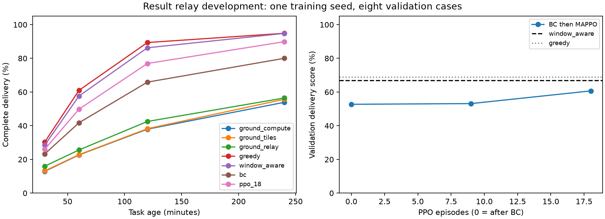

# 结果中继下的任务年龄训练开发协议

日期：2026-10-10。用户确认结果中继属于主模型的合理能力。本轮在既有开发分布上更新共同环境与训练目标，不打开历史测试面板，也不将规则路由称作学习创新。

## 固定条件

- 配置为 `examples/config_relay.yaml`：结果缓存、结果中继和预测接触检查均开启。其余资源与角色协议相同。历史配置不覆盖。
- 场景沿用 `examples/scenario_roles.json` 的训练与验证部分。训练以九回合为周期覆盖 12/24/36 星与 uniform/near/shared 角色的九个组合，轨道相位、高度、负载和带宽继续随机化。八个既有验证案例用于开发，不是新独立测试。
- 星上调度方法共用规则中继；规则服务读取全网即时链路、队列和预测接触窗口。actor 仍使用既有局部输入，网络服务的信息权限不能被省略。
- 接触检查按配置的最低星间带宽估计排队与传输时间，并扣除一个接触扫描周期的余量，拒绝预计无法在接触内完成的路径。它仍是当前图上的启发式，不是完整时变最优路由；未来竞争和预测误差仍可造成暂停。
- 加入 `ground_tiles`：原始分片直接下传到地面逐片计算，不经过星间链路，不执行星上计算。与 `ground_relay` 对比用于控制分片流水线差异。传统整图 `ground_compute` 继续保留。

## 奖励与选模

预先使用 30/60/120/240 分钟四个相对时限，均从任务产生时刻计时。每个任务必须全部结果交付并完成聚合；不以已计算分片代替任务完成。

开发评分为四个时限的完整任务交付率等权平均，再对八个验证案例等权平均。没有为本轮指定一个业务主时限，后续仍需业务依据。评分相同时，比较以最大时限截断的全任务平均时延，未完成任务按最大时限计入，避免仅比较成功子集。

任务完成时，根据其满足的时限数给予 0、0.25、0.5、0.75 或 1 的奖励。episode 总原始奖励等于交付曲线评分的分子，所有任务使用相同规则。由于回合任务数不同，这仍是奖励计数训练，不声称等价于跨场景完成率的精确优化；原有训练按卫星数量缩放共享奖励。使用 gamma=1，避免同样快的晚到任务因绝对回合位置被额外折扣；lambda=1、整回合 rollout 保留远期交付反馈。此开发运行不添加时延奖金或势函数奖励。

环境 6 小时，前 2 小时到达，保留至少 4 小时观察。配置检查会拒绝观察不足、非任务奖励、额外时延奖金或 gamma 不为 1 的新口径训练。旧训练入口仍可使用原协议，旧 checkpoint 不重标为新训练。

## 运行预算

第一轮为 seed 7，9 个训练场景的示范学习（每场景 32 epoch），随后 18 回合 MAPPO，每 9 回合验证。教师为 window_aware；actor 采用 hidden=64 的 task_attention，critic 采用自身与全体均值输入，仅训练时使用。保留 initial、warmstart、best 和 last，以单独检查 BC 与 PPO。

```bash
.venv/bin/python train_marl.py --config examples/config_relay.yaml \
  --scenario-distribution examples/scenario_roles.json \
  --out-dir checkpoints/relay_age_mappo_7_20261010 \
  --algorithm mappo --features role_contact --encoder task_attention \
  --hidden 64 --critic-pooling --warmstart-episodes 9 --warmstart-epochs 32 \
  --warmstart-teacher window_aware --reward-mode task \
  --delivery-horizons-minutes 30,60,120,240 --episodes 18 \
  --rollout-steps 2160 --ppo-epochs 2 --minibatch 512 --lr 0.0001 \
  --gamma 1 --lam 1 --ent-coef 0.002 --eval-every 9 --seed 7 --torch-threads 1
```

对照为 ground_compute、ground_tiles、ground_relay、local、greedy、window_aware，均在同一八个验证案例运行，核对任务轨迹。结果路径为 `results/relay_age_baselines_20261010.json`。这轮是开发学习诊断，不替代多种子正式主实验、IPPO/领域方法对照或结构消融。

## 原始中继退化的已知线索

上一版 shared24_a 的 ground_relay 在结束时有 487 个分片的最后事件为星地下传开始，141 个为星间传输开始，11 个停在入队；仅 345 个分片完成，完整任务 13/123。部分未结束星间传输在第 722 步已开始，而仿真总计 2160 步。该事件证据支持检查断链滞留与下行排队，但不能单凭事件确定全部原因或保证新接触检查一定改善。

开启接触检查后，对同一案例进行了带原始事件和结束状态的诊断，保存于 `results/relay_contact_diagnostic_20261010/`。结束时没有星间在途传输，418 个分片完成，剩余 566 个均处于星地下传中，合计仍待传 4592.53 MB；这些上传都已发起超过一小时。完整任务却只有 10/123。相较旧规则，已完成分片增加而完整任务减少，不能只据分片吞吐评价改动。

当前星地下传按可见卫星轮转，在同卫星多个流间公平分配；上传开始后绑定该站，断开时暂停。这些共同语义会使大量原始分片部分上传后等待下一窗口。结束状态证实下传仍是瓶颈，但区分站点绑定、流间分配和窗口竞争各自的贡献，需要额外受控实验。强地面条件下的另一开发案例已可交付 167/167，不能概括为中继无效或地面算力不足。

## 下行服务顺序控制

额外运行 `analysis/ground_service_diagnostic.py`，只在 shared24_a 诊断下行服务规则。每个卫星/站点组合在一个时间步内只服务最早产生的一个任务，沿用原站端轮转、通道容量和该任务内的流间公平分配。三种方法使用同一替代规则，原始事件、容量检查和脚本指纹保存在 `results/relay_ground_service_20261010/`。该规则未接入本轮 MAPPO 训练配置，诊断结果不混入训练主表。

| 方法 | 30 分钟内 | 60 分钟内 | 120 分钟内 | 240 分钟内 | 仿真结束时 |
|---|---:|---:|---:|---:|---:|
| 分片直传地面 | 7 | 19 | 43 | 54 | 54 |
| 原始分片中继地面 | 2 | 4 | 16 | 46 | 46 |
| window_aware、结果中继 | 18 | 74 | 111 | 122 | 122 |

分母均为 123。相同接触检查下，原流间公平规则的两个地面对照分别为 40 和 10 个完整任务，服务顺序改变后为 54 和 46 个，说明大数据基线存在重要调度空间。本控制一次只服务一个任务，该任务提前传完时不会在同一步转服务下一个任务，可能闲置部分容量；因此它也不是最优的地面策略。正式模型还需明确采用哪种下行服务规则，并对全部策略共同实施与重训。

截至本轮开发，95 项测试通过（其中 1 项为此诊断的优先顺序和容量守恒测试）；完整训练完成情况及最终选模结果见后续结果节。

## 共同环境的基线结果

六种规则方法、八个验证案例，共 48 次运行完成；各方法面对同样的 754 个任务。下表先在每个案例计算交付率，再对案例等权平均，最后对四个时限等权评分；合计完成数是辅助指标。

| 方法 | 多时限评分 | 30 分钟 | 60 分钟 | 120 分钟 | 240 分钟 | 最终完整任务 |
|---|---:|---:|---:|---:|---:|---:|
| 整图地面计算 | 31.85% | 12.92% | 22.66% | 37.95% | 53.88% | 384/754 |
| 分片直传地面 | 32.49% | 13.19% | 22.83% | 38.23% | 55.68% | 399/754 |
| 原始分片中继地面 | 35.14% | 15.99% | 25.62% | 42.52% | 56.46% | 452/754 |
| local + 结果中继 | 10.21% | 0.00% | 0.00% | 8.08% | 32.75% | 316/754 |
| greedy + 结果中继 | 68.90% | 30.35% | 61.01% | 89.37% | 94.87% | 741/754 |
| window_aware + 结果中继 | 66.80% | 28.51% | 57.63% | 86.27% | 94.79% | 741/754 |

结果中继并不能替代计算调度：慢速成像源全部本地计算仍明显受限。另一方面，两种启发式即使最终都交付 741 个任务，其多时限评分也不同，体现了按相同任务年龄评价的必要性。这里没有新增无中继八场景配对组，不能用本表与历史不同协议的表直接相减来量化中继总体增益。

## 完整训练结果

9 个示范场景与 18 回合 MAPPO 均已完成。PPO 阶段处理 1521 个到达任务，九个规模/角色组合各出现两次，每回合实际参与决策的成像星为 4--24 个。验证为同一八案例、754 个任务，未使用测试集。所有基线和验证的源码、任务轨迹与 TLE 指纹核对一致；18 回合的奖励累计均与该回合多时限交付评分分子一致。

| 候选 | 多时限评分 | 30 分钟 | 60 分钟 | 120 分钟 | 240 分钟 | 最终完整任务 |
|---|---:|---:|---:|---:|---:|---:|
| 行为克隆后，第 0 回合 | 52.72% | 23.27% | 41.76% | 65.87% | 80.00% | 586/754 |
| MAPPO 第 9 回合 | 53.14% | 23.72% | 42.31% | 66.42% | 80.10% | 587/754 |
| MAPPO 第 18 回合 | 60.67% | 26.04% | 49.82% | 76.94% | 89.87% | 687/754 |

按预定规则选中第 18 回合。相对同一 BC 初始化，评分增加 7.94 个百分点，新增完成 101 个任务、未丢失 BC 已完成任务。八个案例中七个多时限评分提高，一个不变；主要改善出现在共享计算角色。全任务截断平均时延由 6292.87 秒降至 5065.39 秒。以上是同一训练种子的开发证据，不是独立泛化测试或统计显著性结论。

学习仍未超过强基线：第 18 回合比 window_aware 低 6.13 个百分点、比 greedy 低 8.24 个百分点，最终比两者少完成 54 个任务。已经出现 PPO 相对初始化的改善，但尚未达到“稳定优于已有方法”的论文目标。三种地面规则也不是地面调度的最优解，不能据本轮成绩概括为普遍超过地面计算。

汇总表、配对记录及图在 `results/relay_age_development_final_20261010/`。复算入口：

```bash
.venv/bin/python analysis/summarize_relay_training.py \
  --baselines results/relay_age_baselines_20261010.json \
  --training-dir checkpoints/relay_age_mappo_7_20261010 \
  --output-dir results/relay_age_development_reproduce
```



选中模型位于 `checkpoints/relay_age_mappo_7_20261010/best.pt`，纯 actor 导出为该目录下 `export_selected/actor.pt`。actor 为 28417 参数、FP32 参数 113668 字节、TorchScript 文件 139686 字节；固定 batch=1，输入 [1,254]，输出 [1,4,12]。重载后十组输入 logits 核对通过。本机 CPU 单线程网络中位耗时 0.072 ms、P95 0.079 ms，不含轨道预测、观测构造和 mask，不代表星载硬件性能。追踪导出包含固定 batch 警告，因此不承诺动态 batch。

本轮交付了新环境、统一目标、完整小预算训练及小模型产物。后续针对差距的同状态审计、greedy 混合示范、DAgger 与 PPO 空批次修复见 [学习差距诊断与教师纠偏](imitation_optimization.md)。正式论文仍需合理工作负载标定、领域论文基线、公平消融和未查看测试面板。

后续仍需：按实际业务固定成像轨道与计算/中继轨道设计空间；把广播开销和陈旧信息纳入约束；更细步长敏感性；学习诊断与多种子、同初始化对照；重新保留未查看的正式测试面板。
