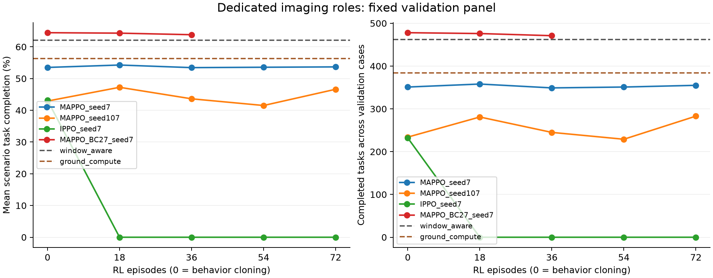

# 角色训练结果与后续工作

更新：2026-10-10。配套协议见 [专用成像角色训练](role_training.md)。本轮完成三个 72 回合训练与一个追加的 36 回合训练；训练规模为 12/24/36 星。全部使用固定的完整任务奖励和确定性验证规则。

后续用户确认采用统一任务年龄时限；本页保留原有实验口径，重算曲线见 [统一任务时限与星间中继](delivery_metric_and_relay.md)。原 checkpoint 未重新选择，不能将事后重算当成新协议下的独立主实验。

## 已确认的结论

1. 多个成像星共享计算资源的场景已实现，事件审计确认存在跨源资源竞争；每回合有 4--24 个实际决策主体。
2. 最好验证成绩 64.46% 来自 27 场景行为克隆后的 episode 0，不能作为强化学习收益。随后 36 回合 PPO 为 63.82%。
3. 原预算的两个 MAPPO 重复分别达到 54.27% 和 47.25%，均低于 window_aware 的 62.07%。IPPO 的最佳模型也来自 episode 0，末轮确定性执行为零完成。
4. actor 有 28417 参数，已验证可独立导出；模型小与调度算法有效是两个不同的验收项。

完整训练汇总：`results/role_training_development_20261010.json`。曲线采用实际验证节点，无平滑，横轴 0 表示示范学习完成时：

## 独立测试协议

2026-10-10 检查四组完整预算结果后，固定各自的 best.pt；它们均由原有验证规则选出。额外固定追加组的 last.pt，作为同组 PPO 前后对照，不能根据测试结果改选为部署模型。测试为六个预留案例，任务种子 91001--91006，包含未见 48 星规模；它同时改变部分带宽、负载和轨道条件，不能单独解释为规模泛化。

对照包括全地面、本地、greedy、window_aware、predictive。所有策略在相同任务轨迹上执行；汇总前核对源代码版本、场景定义和任务轨迹哈希。独立测试用于评估这一轮固定候选，不作为下一轮调参依据。若后续开发方法，须另建未查看的新测试面板，并保留本轮结果。

## 独立测试结果

共 10 个策略/模型、6 个案例、60 次完整运行。每种策略面对同样的 741 个任务，任务轨迹与仿真源码哈希核对通过。模型完全按先前的验证规则选择，没有测试后重选 checkpoint。

| 方法 | 场景平均完成率 | 合计完成任务 |
|---|---:|---:|
| 全地面 | 71.79% | 518/741 |
| 本地 | 34.86% | 218/741 |
| greedy | 67.83% | 482/741 |
| window_aware | 68.01% | 490/741 |
| predictive | 64.95% | 473/741 |
| MAPPO seed 7，验证最佳第 18 回合 | 57.02% | 384/741 |
| MAPPO seed 107，验证最佳第 18 回合 | 48.43% | 300/741 |
| IPPO seed 7，验证最佳为示范后第 0 回合 | 43.91% | 247/741 |
| 27 场景行为克隆，验证最佳第 0 回合 | 67.79% | 498/741 |
| 同一初始化再做 36 回合 PPO，固定末轮对照 | 67.09% | 493/741 |

主指标先在每个案例计算完成率，再对六个案例等权平均，不等于合计完成数除以 741。行为克隆比 window_aware 多交付八个任务，但其场景平均完成率低 0.22 个百分点，不能事后改成合计完成数排名来宣称主要指标获胜。角色与规模案例只有各两个任务种子，表中不提供总体或训练重复的置信区间。

| 候选 / 参照 | 共同完成 | 仅候选完成 | 仅参照完成 | 共同任务平均时延差（候选减参照） |
|---|---:|---:|---:|---:|
| 行为克隆 / window_aware | 473 | 25 | 17 | -108.10 s |
| 行为克隆 / 全地面 | 472 | 26 | 46 | -612.75 s |
| 后续 PPO / 行为克隆 | 490 | 3 | 8 | +47.27 s |

行为克隆在与全地面共同完成的任务上较快，但有 46 个全地面可完成的任务未完成，仅新增 26 个，完整任务优先的应用目标尚未达到。配对时延只适用于共同完成子集，仍不代表全部请求的交付时延。PPO 后较行为克隆少完成五个任务，场景平均完成率下降 0.70 个百分点，共同任务平均慢 47.27 秒；本轮没有观察到它的增益。

结果文件：`results/role_test_20261010.json`，包含所有原始指标、按案例的配对结果、模型 SHA256 与输入分片路径；训练及测试摘要为 `results/role_training_final_20261010.json`。分片 `role_test_baselines_20261010.json`、`role_test_original_20261010.json`、`role_test_warm27_20261010.json` 保留原始运行输出。分片中的案例 bootstrap 不代表训练重复不确定性，合并表不使用它作显著性判断。

本轮结论是：充分示范能够形成可执行的小模型，但其验证集优势没有转化为主要测试指标优势；继续 PPO 也没有改善。该结果不足以否定多智能体调度方向，却明确要求先解决学习有效性与初始化对照，再开展正式论文主实验。

## 下一步验收

- 先解释随机采样与确定性执行的差异，检查等待动作、策略熵和完整任务奖励的延迟。当前诊断不能直接证明具体损失函数或 critic 是原因。
- 在开发集上固定同一示范 actor，对照行为克隆、IPPO、MAPPO；控制初始化、示范数量和更新预算，避免把额外示范收益归给集中训练。
- 检查价值拟合、优势估计、策略更新幅度和探索强度；先做小预算多种子诊断，再决定是否扩大训练。不能只增加回合数。
- 学习有效后再做至少五个独立训练重复、同输入结构对照、去任务/去窗口消融、领域论文方法适配比较以及参数标定。
- 全地面对照必须兼顾完整任务完成率与共同完成任务时延；还需只在地面计算的分片流水线控制，区分架构与调度的收益。

中期论文可以据此写清模型、方法、仿真验证和当前失败原因的证据边界；主张“多智能体强化学习稳定优于强基线”仍未达到验收要求。

## 执行规则诊断

固定开发案例 shared24_a，共 123 个任务；随机执行使用策略种子 101、202、303。九次随机运行与对应确定性验证共享任务到达轨迹。下面的三列不是独立训练重复，也不是测试集成绩。

| 模型 | 确定性执行完成数 | 随机执行完成数（101 / 202 / 303） |
|---|---:|---|
| IPPO seed 7，PPO 72 回合 | 0 | 30 / 30 / 29 |
| 27 场景行为克隆，PPO 前 | 78 | 42 / 41 / 43 |
| 同一初始化，PPO 36 回合 | 78 | 42 / 41 / 44 |

IPPO 的确定性验证八个案例均只输出 WAIT，零完成不能解释为这些场景完全没有交付机会。行为克隆模型在随机执行时明显低于确定性执行，追加 PPO 的三个诊断种子也没有提供明显的改善证据。训练优化随机动作分布的回报，而既定选模与测试执行 argmax，两者的效果差异是已观察到的现象；它尚不能证明崩溃由熵项、价值拟合或奖励延迟中的某一个因素导致。

诊断文件为 `results/role_ippo_sampling_20261010.json`、`results/role_bc27_sampling_20261010.json`、`results/role_bc27_ppo36_sampling_20261010.json`。没有据这些诊断临时改变本轮测试执行规则。

## 小模型交付

按照验证规则选出的充分示范模型已导出到 `checkpoints/roles_mappo_warm27_7_v2_20261009/export_selected_20261010/actor.pt`，配套 `profile.json` 保存 checkpoint 哈希、输入输出形状和性能口径。模型有 28417 参数，FP32 参数共 113668 字节，导出文件 139686 字节。

重载导出文件后，十组输入的 logits 与原模型核对通过。固定单星输入形状为 [1,254]，输出 [1,4,12]，不承诺动态 batch。当前本机 CPU 单线程纯网络推理中位数为 0.098 ms、P95 为 0.173 ms；测量时其他评估进程仍在运行，不包含轨道预测、观测构造和动作 mask，不能解释成星载硬件性能或调度算法优势。
