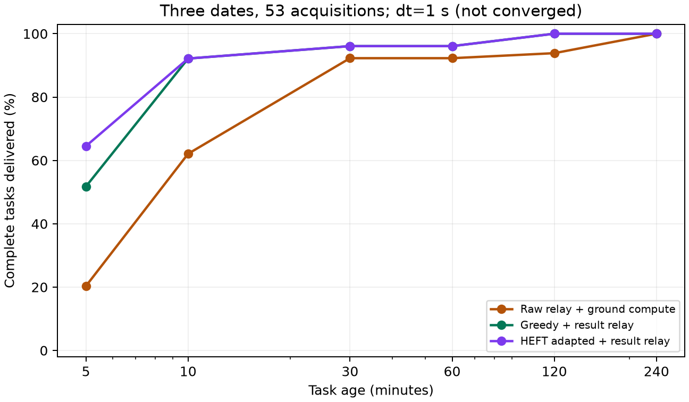

# 高分遥感场景实验报告

日期：2026-10-15。公开设备通信规格支持的网络层仿真，计算和图像输出仍为受控代理。没有在这组新场景训练或评估MARL，不能把规则策略成绩写成强化学习成绩。

**验收结论：当前未通过关键时间步稳定性检查。下列1秒主表仅用于开发诊断，不能作为论文中的稳定加速结论。原始中继在0.1秒步长出现路径绕行，必须先处理并重跑。**

## 1. 场景与证据

2颗620 km、97.9度成像星；22颗550 km、53度计算中继星；美国五个民用区域成像，北京坐标单接收站。保持固定日期和全部合格成像事件，首日21幅，连续三天共53幅。各日独立从空队列开始，每个任务都跟踪至少4小时。

- 星间10 Gbps，另测同系列2.5 Gbps；星地双通道合计1.2 Gbps。效率1.0为上限抽象，0.8为敏感性假设。
- 每幅原生PAN/MS约6.417 GB，3:1压缩后2.139 GB；固定200像素overlap产生4617窗口、315包，分片输入合计3.328 GB。
- 每包最多16窗口、11.534 MB。完整窗口容量充足不等于有空闲接入或可持续路由；每一步仍执行共享带宽、缓存、断链和计算队列。
- 通信证据：[设备参数依据](../../docs/thesis/highres_link_evidence.md)；配置理由与边界：[实验协议](../../docs/thesis/highres_scene_protocol.md)；[轨道几何审计](../../docs/thesis/highres_geometry_audit.md)；[包长与窗口审计](../highres_contact_audit_20261015.md)。

源星在本次观察期没有北京直传窗口，下一直接窗口等待约8.03至11.28小时。故两个直传控制组为0不能证明协同计算优势；有意义的地面对手是允许多星中继的ground_relay。

## 2. 首日完整基线

| 方法 | 完整交付/到达 | 5分钟 | 10分钟 | 30分钟 | 60分钟 | 240分钟 | 截断平均时延(s) |
|---|---:|---:|---:|---:|---:|---:|---:|
| 源星整图直传+地面计算 | 0/21 | 0.00% | 0.00% | 0.00% | 0.00% | 0.00% | 14400.00 |
| 源星分片直传+地面计算 | 0/21 | 0.00% | 0.00% | 0.00% | 0.00% | 0.00% | 14400.00 |
| 原始分片中继+地面计算 | 21/21 | 19.05% | 66.67% | 95.24% | 95.24% | 100.00% | 738.05 |
| 源星本地计算+结果中继 | 21/21 | 0.00% | 14.29% | 76.19% | 95.24% | 100.00% | 1360.05 |
| 贪心协同+结果中继 | 21/21 | 66.67% | 100.00% | 100.00% | 100.00% | 100.00% | 299.19 |
| 窗口感知协同+结果中继 | 21/21 | 33.33% | 61.90% | 95.24% | 95.24% | 100.00% | 805.43 |
| HEFT适配+结果中继 | 21/21 | 85.71% | 100.00% | 100.00% | 100.00% | 100.00% | 250.95 |
| 接触图计算适配+结果中继 | 21/21 | 85.71% | 100.00% | 100.00% | 100.00% | 100.00% | 250.62 |

所有星上策略采用共同的结果中继；地面中继也执行相同的实际链路和竞争约束。HEFT/CGS是文献方法适配，不能写成原论文端到端复现。最终交付数相同，不代表早期任务年龄交付率和时延相同。

## 3. 连续日期面板

| 方法 | 完整交付/到达 | 5分钟 | 10分钟 | 30分钟 | 60分钟 | 240分钟 | 截断平均时延(s) |
|---|---:|---:|---:|---:|---:|---:|---:|
| 原始分片中继+地面计算 | 53/53 | 20.34% | 62.09% | 92.27% | 92.27% | 100.00% | 1284.89 |
| 贪心协同+结果中继 | 53/53 | 51.76% | 92.16% | 96.08% | 96.08% | 100.00% | 541.72 |
| HEFT适配+结果中继 | 53/53 | 64.52% | 92.16% | 96.08% | 96.08% | 100.00% | 509.39 |

上述比例和时延按日等权；完成数汇总。三个日期分别21、15、17个任务，不是53个独立轨道样本，也没有统计显著性结论。

| 日期 | 方法 | 10分钟交付率 | 截断平均时延(s) |
|---|---|---:|---:|
| 2026-10-15 | 贪心协同+结果中继 | 100.00% | 299.19 |
| 2026-10-15 | 原始分片中继+地面计算 | 66.67% | 738.05 |
| 2026-10-15 | HEFT适配+结果中继 | 100.00% | 250.95 |
| 2026-10-16 | 贪心协同+结果中继 | 100.00% | 251.27 |
| 2026-10-16 | 原始分片中继+地面计算 | 66.67% | 1288.27 |
| 2026-10-16 | HEFT适配+结果中继 | 100.00% | 225.27 |
| 2026-10-17 | 贪心协同+结果中继 | 76.47% | 1074.71 |
| 2026-10-17 | 原始分片中继+地面计算 | 52.94% | 1828.35 |
| 2026-10-17 | HEFT适配+结果中继 | 76.47% | 1051.94 |

## 4. 单因素敏感性

均采用完整首日21幅；同一变体内各方法仍有一致的任务、轨道和配置。

| 变体 | 方法 | 5分钟交付率 | 10分钟交付率 | 六时限J | 截断平均时延(s) |
|---|---|---:|---:|---:|---:|
| 通信净荷效率0.8 | 原始分片中继+地面计算 | 14.29% | 61.90% | 77.78% | 766.43 |
| 通信净荷效率0.8 | 贪心协同+结果中继 | 66.67% | 100.00% | 94.44% | 299.19 |
| 通信净荷效率0.8 | 源星本地计算+结果中继 | 0.00% | 14.29% | 64.29% | 1360.05 |
| 地面参考能力乘10 | 原始分片中继+地面计算 | 80.95% | 95.24% | 94.44% | 431.05 |
| 地面参考能力乘10 | 贪心协同+结果中继 | 66.67% | 100.00% | 94.44% | 299.19 |
| 仅星间降至设备2.5 Gbps档 | 贪心协同+结果中继 | 28.57% | 95.24% | 87.30% | 384.29 |
| 仅星间降至设备2.5 Gbps档 | 原始分片中继+地面计算 | 19.05% | 33.33% | 72.22% | 1148.57 |

地面能力乘10是代理算力敏感性，不是新增服务器实测。应比较各时限而不只挑一个均值；较快地面可在紧时限下优于某些协同策略。

## 5. 时间步检查

固定首个成像窗口3幅图，保持星上策略决策每1 s、几何每10 s，比较执行dt=1 s和0.1 s。原始中继当前每个执行步重新选路，其控制频率也随dt变化。这个小面板不代表全日已收敛。

| 方法 | dt=1s平均时延(s) | dt=0.1s平均时延(s) | 两步长共同完成 |
|---|---:|---:|---:|
| 原始分片中继+地面计算 | 190.00 | 1732.40 | 3/3 |
| 贪心协同+结果中继 | 219.67 | 216.20 | 3/3 |

原始中继补充步长结果：

| dt(s) | 平均时延(s) | J |
|---:|---:|---:|
| 1 | 190.00 | 100.00% |
| 0.5 | 194.00 | 100.00% |
| 0.25 | 195.92 | 100.00% |
| 0.1 | 1732.40 | 55.56% |

这不是可以忽略的毫秒舍入：0.1秒原始中继发生了大范围路径改变，而接收总字节不变。不能仅凭1、0.5、0.25秒接近就宣布收敛，也不能把0.1秒下更大的协同优势用作宣传。

## 6. 能支持与不能支持的结论

真实设备规格量级的高速链路并不自动消除协同空间。该场景中，多星中继首先解决源星接收窗口的缺失，计算放置再影响并行度、地面队列和结果回传时机。不能只与无中继直传组比较。

本轮还不能支持：MARL优于启发式；实际星载GPU上有相同比例加速；完整终端能在所有几何边上持续满速；图像压缩后精度不变；全年或所有星座都获益。

后续优先补齐：

1. 修复或重新定义原始中继的控制时序和路径重选，完成时间步稳定性验证；当前主表暂不用于方法优越性论证。
2. 原生PAN/MS到模型输入的预处理、实际边缘硬件与地面服务器计时，以及高分条带的结果体积和全局合并开销。
3. 原始影像无重复分块中继、地面重组后再生成overlap的更强地面对照；当前ground_relay仍传输重叠像元。
4. 激光捕获/跟踪限制、几何时间分辨率、跨轨失联与更广日期/相位面板；不能仅靠固定效率0.8代替物理验证。
5. 在该协议中重新构建多场景训练分布，统一MARL和规则策略的可决策吞吐，使用已测强教师并保留独立轨道日期测试。

## 7. 产物与复现

所有输入、逐任务输出和源码哈希保存在下列目录；没有把较差结果从面板移除。

- [highres_nominal_ground_20261015](../highres_nominal_ground_20261015/summary.md)
- [highres_nominal_star_20261015](../highres_nominal_star_20261015/summary.md)
- [highres_nominal_literature_20261015](../highres_nominal_literature_20261015/summary.md)
- [highres_three_days_20261015](../highres_three_days_20261015/summary.md)
- [highres_eta08_20261015](../highres_eta08_20261015/summary.md)
- [highres_ground10x_20261015](../highres_ground10x_20261015/summary.md)
- [highres_isl2500_20261015](../highres_isl2500_20261015/summary.md)
- [highres_dt1_20261015](../highres_dt1_20261015/summary.md)
- [highres_dt05_20261015](../highres_dt05_20261015/summary.md)
- [highres_dt025_20261015](../highres_dt025_20261015/summary.md)
- [highres_dt01_20261015](../highres_dt01_20261015/summary.md)

执行入口：`analysis/evaluate_highres_scene.py`；敏感性配置生成：`analysis/prepare_highres_sensitivity.py`；本汇总：`analysis/report_highres_scene.py`。本轮核心测试256项通过。
