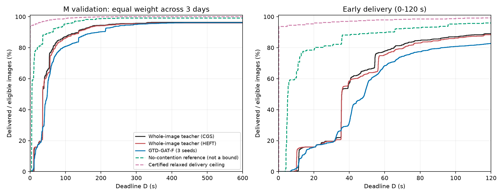

# 教师协同消融与两层无争用分析

仅M档2026-10-22～24验证日，原每日最忙6小时窗口、相同评分ID及至少600秒随访。新最终测试继续封存。
新增3个完整HEFT协同评估、3个离线分析任务；对照复用本日关卡1同代码的3份已审计baseline。GTD-GAT-F复用原冻结三种子所选检查点的9份验证记录，不重新选模。

|方法|P60 %|P120 %|P600 %|R600 s|未完成（3日合计；F再均种子）|
|---|---:|---:|---:|---:|---:|
|全局整图复核（CGS协同）|77.8280|89.1447|96.3477|70.637085|16|
|全局整图复核（HEFT协同）|75.3627|88.4522|95.9520|73.702096|17|
|GTD-GAT-F（三种子均值）|68.3857|82.7264|96.1391|85.394379|17|
|无争用参考（非理论界）|89.7461|95.9503|99.1114|24.199438|NA|
|独立窗口/无限带宽时延下界|97.9270|99.2086|100.0000|3.656735|NA|

## 协同规划器消融

HEFT减CGS：P60 -2.4652 pp，P120 -0.6925 pp，P600 -0.3957 pp，R600 +3.065011 s，未完成 +1 图。
只替换完整未承诺图像C4/C16的块级候选；整图选择、共享日历报价、整图保护、破同分与顺序承诺保持原实现。残余/已承诺分片仍用旧CGS回退。日志cgs_4/cgs_16键在HEFT组表示HEFT产生的协同候选。
差值只支持这一组合中的规划器比较；不说明HEFT或CGS在任意任务图上普遍占优。

## 与两层分析的差距

|比较（前者减后者）|P60差 pp|P600差 pp|R600差 s|R600差的配对日95%区间 s|
|---|---:|---:|---:|---|
|teacher_minus_reference|-11.9181|-2.7637|+46.437647|[44.88068571428571, 47.69726528189912]|
|teacher_minus_lower|-20.0990|-3.6523|+66.980351|[65.23072802065285, 68.70941837612568]|
|F_minus_reference|-21.3604|-2.9723|+61.194941|[49.806633236151605, 70.21722475049901]|
|F_minus_lower|-29.5413|-3.8609|+81.737645|[70.15667554251874, 92.19165390506778]|

参考不可报价图数：9；下界图中无有限路径图数：0。这些不是可执行方法的未完成图数。
无争用参考保留原有限接触计划、4/16分块、输入权限、代理字节、量化及报价近似。它既不是理论界，也不是在执行器中逐图隔离运行的策略成绩；不能将与教师的全部差值归因于争用。
严格层是零序列化/独立窗口的强放宽：无限带宽、无排队/资源竞争/内存限制，删除建链等待，不限跳数，允许所有位置取全局最短单窗服务；保留完整执行网格接触时序和不向上量化的固定合并项。时延下界对应P_D比例上界。与其差距不能当作现有有限带宽下可实现的提升。
完整放宽项、算法及可行域包含证明见 docs/thesis/TEACHER_BOUND_IMPLEMENTATION_20261111.md；只保证登记仿真模型下D<=600和R600，不声称物理世界最优、无限时域完成时间或有限带宽的紧界。

## 三种子与逐日结果

|种子|P60 %|P120 %|P600 %|R600 s|未完成3日合计|
|---|---:|---:|---:|---:|---:|
|1701|68.2168|83.4204|96.2375|84.397136|15|
|1702|69.9999|82.6280|95.4470|85.974668|21|
|1703|66.9403|82.1308|96.7329|85.811333|15|

逐日指标、五类配对差、日等权/种子平均、选择分布与输入hash见 report/summary.json；全阶梯见 report/curves.json。
10000次paired-day bootstrap，seed20261111，三天仅为描述性区间，不校正验证开发选择偏差。未完成区间采用每日计数；主表未完成是三日合计。

## 审计与墙钟

发布前全套793测试通过；新增下界12项和消融6项共同18项通过。三个完整评估与三个离线任务均Mac执行，devbox3仅作队列服务；无需跨架构一致性假设。
独立审计检查所有登记hash、六任务唯一归属/原字节、原模型哈希/同配置/评分ID/随访、资源分段守恒、全部曲线与指标、接触见证及逐图截断支配。资源审计是保存计数器核验，不是逐包重放。见INDEPENDENT_AUDIT.json和REPORT_COMPLETE.json。
运行预估：HEFT1～2小时，两层分析0.5～1小时；实际从worker发布到全部队列确认：HEFT 72.54 分钟，两层分析 17.70 分钟。两批并行，总等待不等于两者之和。
实现/登记和提交耗时见DELIVERY.md。关卡1不通过的既有结论不变，本报告不启动学习或最终评估。

