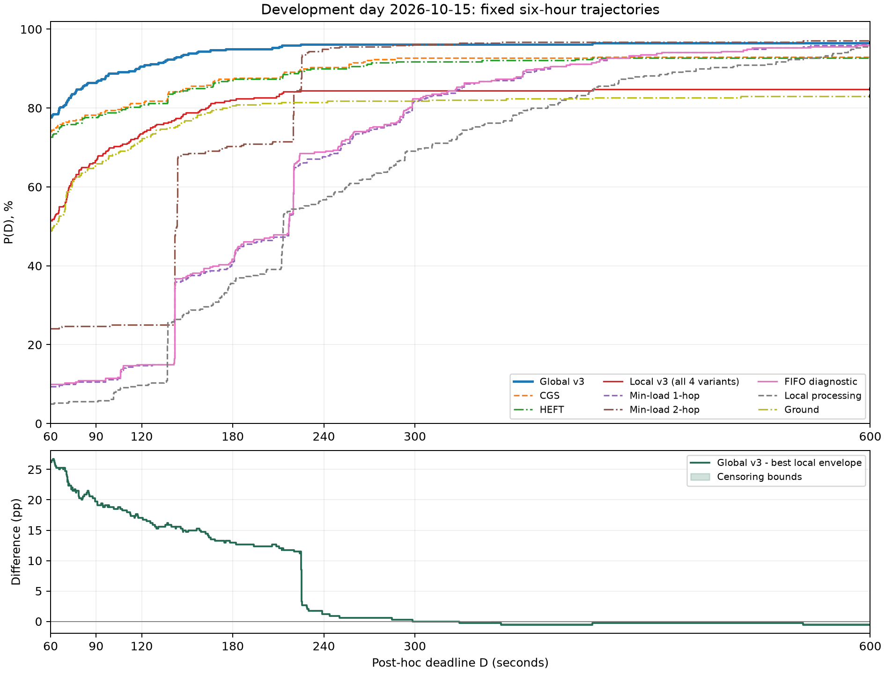

# 主场景M：开发日事后时限曲线

仅复算2026-10-15同一六小时的12份已有记录，每种方法340张主窗口图像；排除2张预热图。没有新仿真、训练或测试日期访问。

## 评分口径

P_D分母固定340；已完成且真实整图交付时延≤D计成功。未完成且观察年龄<D记不可判定，报告[已知成功/340, (已知成功+不可判定)/340]，不删除末尾图像、不将短随访当失败。
原实验无硬截止淘汰，D=300用于评分而非超时杀任务；本表只是同一轨迹的事后阈值，不代表针对新D重新优化。原尾随301秒，实际最末图随访346秒。
P600中，全局v3、强地面、四个局部v3均有task_341一张不可判定（346秒）；其余方法该图已交付，所以P600可确定。区间宽度1/340=0.2941个百分点。
平均/P50/P90只对截至仿真结束已完整交付的图像计算，不截断；未完成另列，分位数用线性插值。不能把这些条件均值称作包含未完成图像的总体平均，不能用不同完成子集的均值单独判断优劣。存在未完成图像的方法，其全体图像平均时延仍未知；本地340张均已完成。

## P_D曲线（%）

|方法|60s|90s|120s|180s|240s|300s|600s|
|---|---:|---:|---:|---:|---:|---:|---:|
|全局 v3|77.65|86.47|90.59|95.00|96.18|96.18|[96.47, 96.76]|
|CGS|74.12|78.24|81.18|87.35|90.29|92.65|92.94|
|HEFT|72.65|77.65|80.59|87.06|90.00|91.76|92.65|
|局部 v3 零负载 1跳|51.47|66.76|73.53|82.06|84.41|84.41|[84.71, 85.00]|
|局部 v3 零负载 2跳|51.47|66.76|73.53|82.06|84.41|84.41|[84.71, 85.00]|
|局部 v3 历史均值 1跳|51.47|66.76|73.53|82.06|84.41|84.41|[84.71, 85.00]|
|局部 v3 历史均值 2跳|51.47|66.76|73.53|82.06|84.41|84.41|[84.71, 85.00]|
|局部最小负载 1跳|9.41|10.59|14.71|40.88|67.65|81.76|96.18|
|局部最小负载 2跳|24.12|24.71|25.00|70.29|95.00|96.18|97.06|
|最近计算星 FIFO（诊断）|10.00|10.88|15.00|41.76|68.82|82.35|95.88|
|本地|5.00|5.59|9.71|35.59|56.76|69.12|95.59|
|强地面|48.82|65.59|71.76|80.59|81.47|81.76|[82.94, 83.24]|

## 完整已交付图像时延（秒）

|方法|完成|未完成|均值|P50|P90|
|---|---:|---:|---:|---:|---:|
|全局 v3|334|6|133.80|35.80|97.48|
|CGS|325|15|194.15|35.10|163.92|
|HEFT|328|12|261.66|36.30|172.51|
|局部 v3 零负载 1跳|312|28|479.67|51.00|192.72|
|局部 v3 零负载 2跳|312|28|479.67|51.00|192.72|
|局部 v3 历史均值 1跳|312|28|479.67|51.00|192.72|
|局部 v3 历史均值 2跳|312|28|479.67|51.00|192.72|
|局部最小负载 1跳|335|5|270.29|216.80|371.16|
|局部最小负载 2跳|334|6|190.15|142.00|225.20|
|最近计算星 FIFO（诊断）|335|5|268.66|216.80|370.96|
|本地|340|0|263.90|213.20|485.98|
|强地面|310|30|575.94|51.50|314.37|

## 与最强局部规则的差距

逐D取六项局部规则的最大P_D，形成事后包络，不是一套预先选定的可执行策略。四个局部v3在七个阈值均并列；FIFO为诊断不参与此六项排名，将FIFO纳入不会改变任何阈值的最强值。

|D(s)|最强局部规则|v3减最强局部(pp)|
|---:|---|---:|
|60|局部v3四变体并列|+26.1765|
|90|局部v3四变体并列|+19.7059|
|120|局部v3四变体并列|+17.0588|
|180|局部v3四变体并列|+12.9412|
|240|局部最小负载 2跳|+1.1765|
|300|局部最小负载 2跳|+0.0000|
|600|局部最小负载 2跳|[-0.5882, -0.2941]|

七个指定阈值中最大差距在D=60秒：v3 264/340、最强局部175/340，+89图、+26.1765个百分点。60/90/120秒分别差26.18/19.71/17.06个百分点；短时限60–120秒是差距较明显区间，不能据此只报告60秒。

逐个真实交付时刻计算60–600秒阶梯包络，最大差距及其半开区间（不是插值）为：
- [61.4, 62.1)秒：26.7647个百分点。

实施计划暂建议D=60秒作按时奖励阈值，依据仅为开发日七档探索；这不是业务SLA或独立测试证据，需用户确认后固定。正式汇报报告整条预定曲线，不能只报择优D。

全局v3已完成334张，平均133.80秒；2跳最小负载也完成334张，平均190.15秒（完成集合不同）。此前84.86秒差对应R300；当前未截断条件均值差为56.35秒。局部v3的R300≈98.82秒，但完整已交付均值≈479.67秒，说明截断指标隐藏了长尾，不应笼统称其平均时延更优。

未来评价需同时报告P_D整条曲线、完成/未完成数、已完成均值和分位数，并补充统一随访下R600，避免以丢弃慢任务改善均值。全局v3是信息更充分的经验参考，不是数学上界；原99.7059%协议上界仅对应D300，不能用于其他D。

文件：deadline_curve.csv（84行）、latency_summary.csv（12行）、per_image.csv（4080行）、summary.json（含逐D按时/不可判定任务ID）、gap_intervals.json（完整阶梯差距）、AUDIT.json（输入输出哈希）。
