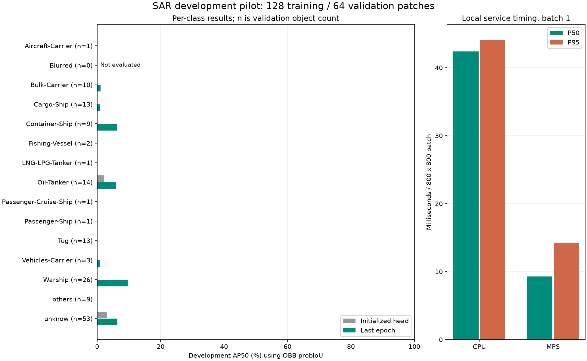

# SAR细船型识别开发试跑

运行状态：completed；完成10/10轮；训练耗时1.67分钟。

## 固定比较

| 开发验证指标 | 正确初始化epoch0 | 固定最后epoch |
| --- | ---: | ---: |
| AP50（有真值类均值） | 0.39% | 2.23% |
| AP50:95（有真值类均值） | 0.13% | 0.72% |

验证支持14/15类。这是Ultralytics OBB probIoU指标，不能直接与原论文polygon IoU AP比较，也不是军民二分类正确率。单次小样本试跑不构成可靠性或显著性证据。

| 原生类别 | 训练目标 | 验证目标 | 最后epoch AP50 | AP50:95 |
| --- | ---: | ---: | ---: | ---: |
| Aircraft-Carrier | 1 | 1 | 0.00% | 0.00% |
| Blurred | 1 | 0 | N/A | N/A |
| Bulk-Carrier | 22 | 10 | 1.13% | 0.22% |
| Cargo-Ship | 34 | 13 | 0.88% | 0.39% |
| Container-Ship | 14 | 9 | 6.29% | 1.47% |
| Fishing-Vessel | 1 | 2 | 0.00% | 0.00% |
| LNG-LPG-Tanker | 1 | 1 | 0.00% | 0.00% |
| Oil-Tanker | 18 | 14 | 5.98% | 2.90% |
| Passenger-Cruise-Ship | 1 | 1 | 0.00% | 0.00% |
| Passenger-Ship | 4 | 1 | 0.00% | 0.00% |
| Tug | 12 | 13 | 0.00% | 0.00% |
| Vehicles-Carrier | 5 | 3 | 0.93% | 0.37% |
| Warship | 68 | 26 | 9.67% | 2.34% |
| others | 5 | 9 | 0.00% | 0.00% |
| unknow | 84 | 53 | 6.40% | 2.40% |

## 本机服务耗时

| 设备 | 平均 | P50 | P95 | 平均输出字节 |
| --- | ---: | ---: | ---: | ---: |
| cpu | 42.70 ms | 42.38 ms | 44.13 ms | 28.0 |
| mps | 10.12 ms | 9.28 ms | 14.20 ms | 28.0 |

输入为已解码800×800图像、网络尺寸832；包含预测、CPU坐标和OBB1序列化，不含整图解码、滑窗提取、跨窗合并和传输。低质量模型可能漏检并产生偏小输出；这些字节数不能直接冻结为正式仿真负载。CPU/MPS是同一本机的代理，不是星上与地面服务器硬件标定。

## 数据与边界

- 数据下载：153.0 MiB；没有下载完整ZIP。
- 来源使用明确标记为临时分组的文件名前缀，训练与开发验证没有前缀交集；文件/像素哈希和局部相关筛查通过，不等于已证明真实原图或船舶身份独立。
- 首轮整图排除含越界、退化或不支持难度标注的样本，结果不能推广到边缘目标。
- 无最终识别测试集，未运行调度封存日期；没有新P_300或调度算法优胜结论。
- 光学预训练只用作初始化，分类末层已重置并核对训练入口哈希。
- 检查点：`/Users/bytedance/Projects/bs/checkpoints/sar_pilot_20261015/train/weights/last.pt`；SHA256 `bb36d1c7d37ae7733b315d4af2bf0a856c8bff34afd32f7298ff52a07b355c36`。

